# CRM — Field Service Management Platform

A full-stack, multi-tenant CRM for service businesses. Office staff manage leads, scheduling, and employees from a web dashboard, while field technicians use the CRM mobile app to pick up jobs, record services, capture before/after photos, and send invoices to customers.

Built solo end-to-end: database schema, REST API, authentication, AWS integration, admin dashboard, and mobile app.


---

## 📱 Mobile App — Screenshots

> The mobile app and its production backend are kept in private repositories for security reasons. The screenshots below are from the working app; customer details shown are demo data.

### 1. Pick up a job

<table>
  <tr>
    <td align="center"><br><sub>Launch screen</sub></td>
    <td align="center">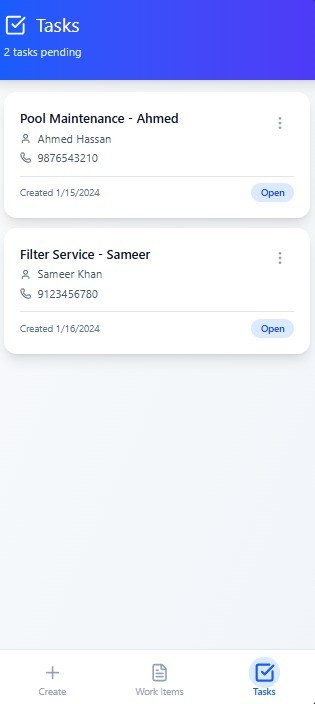<br><sub>Pending tasks</sub></td>
    <td align="center">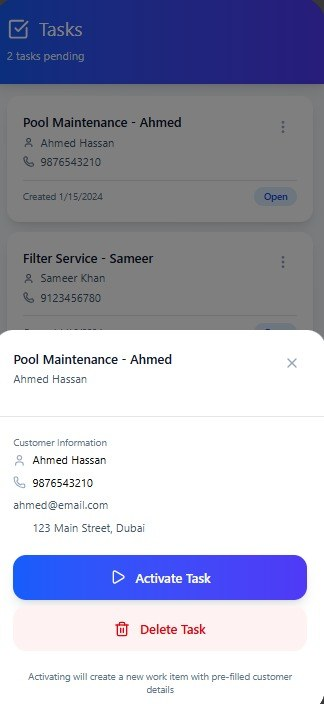<br><sub>Task details: activate or delete</sub></td>
    <td align="center">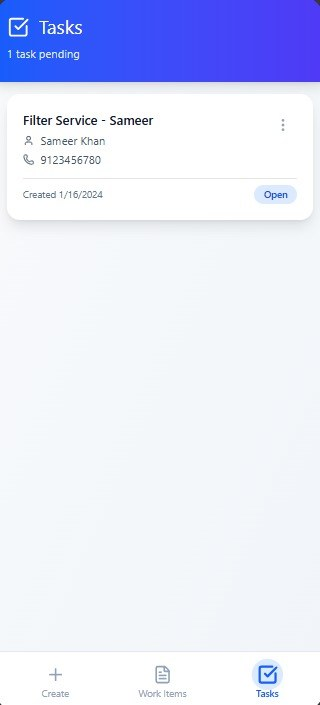<br><sub>Activated task leaves the queue</sub></td>
  </tr>
</table>

### 2. Create the work item and invoice

<table>
  <tr>
    <td align="center">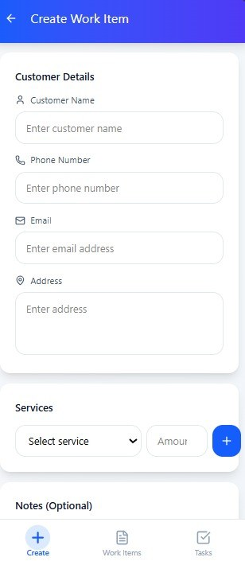<br><sub>Customer details</sub></td>
    <td align="center">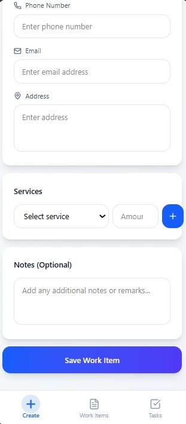<br><sub>Services, amounts and notes</sub></td>
    <td align="center">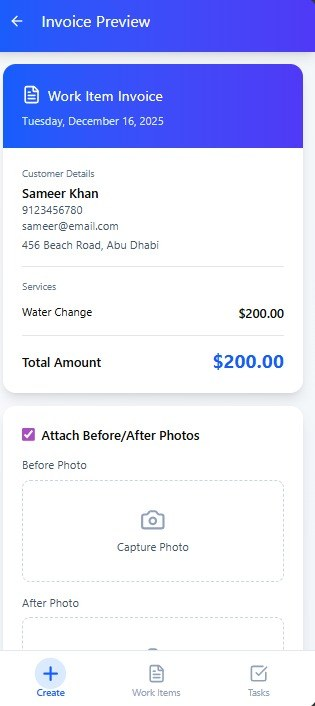<br><sub>Invoice preview</sub></td>
    <td align="center">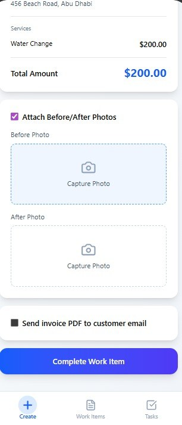<br><sub>Photos and email-PDF options</sub></td>
  </tr>
</table>

### 3. Track work from active to completed

<table>
  <tr>
    <td align="center">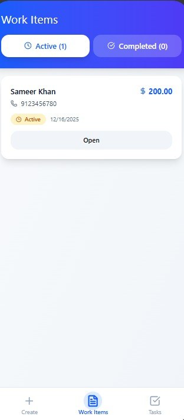<br><sub>Active work items</sub></td>
    <td align="center">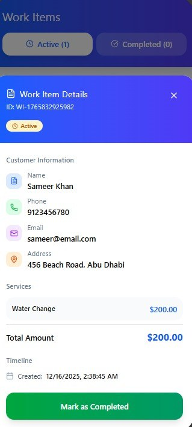<br><sub>Details: mark as completed</sub></td>
    <td align="center">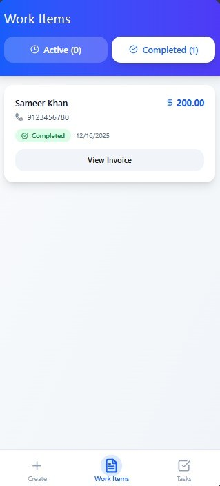<br><sub>Completed work items</sub></td>
    <td align="center">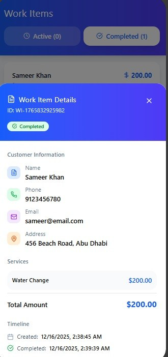<br><sub>Timeline: created and completed</sub></td>
  </tr>
</table>

### 4. Multiple services and before/after photos

<table>
  <tr>
    <td align="center">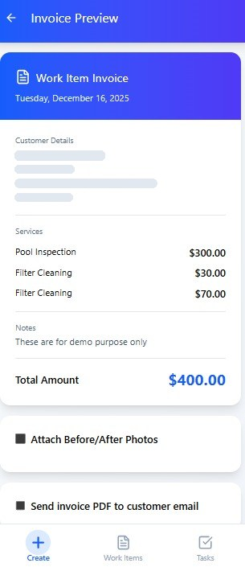<br><sub>Invoice with several services</sub></td>
    <td align="center">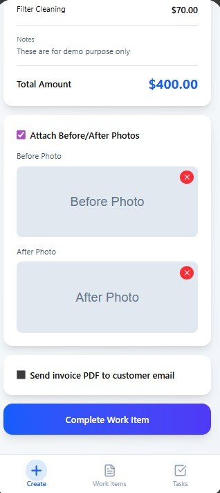<br><sub>Before/after photos attached</sub></td>
    <td align="center">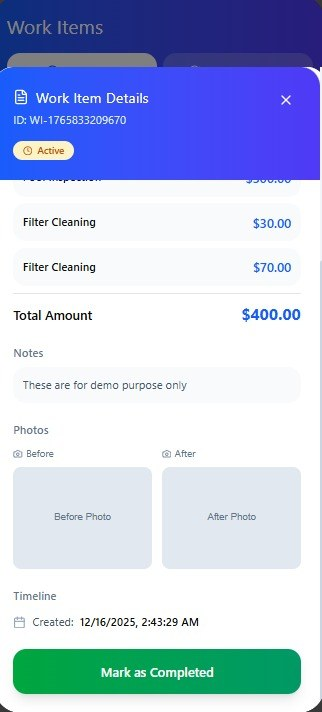<br><sub>Photos saved with the job</sub></td>
    <td align="center">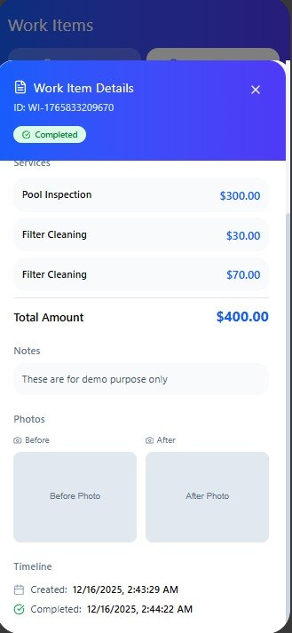<br><sub>Completed job with photos</sub></td>
  </tr>
</table>

### 5. History and empty states

<table>
  <tr>
    <td align="center">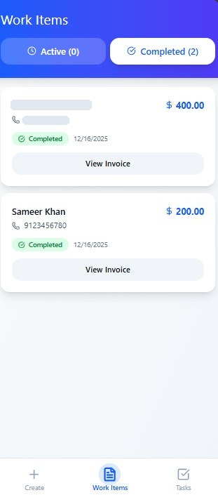<br><sub>Completed history with totals</sub></td>
    <td align="center">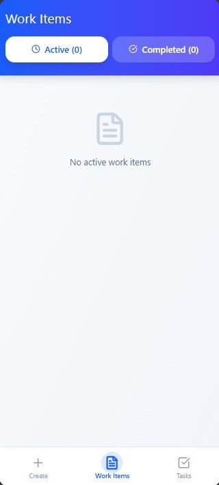<br><sub>No active work items</sub></td>
    <td align="center">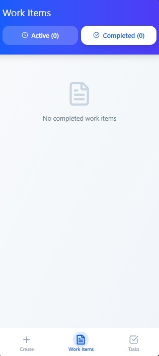<br><sub>No completed work items</sub></td>
  </tr>
</table>

---

## ✨ What It Does

### Field technician mobile app
- **Task queue**: see assigned jobs with customer name and phone; activating a task creates a work item pre-filled with the customer's details
- **Work items**: record customer details, add multiple services with amounts, and leave notes
- **Invoices**: itemized invoice preview with the total, optional before/after photos, and the option to email the invoice PDF to the customer
- **Tracking**: Active and Completed tabs, a details view with a work item ID, and a created/completed timeline

### Admin dashboard and API (this repository)
- **Lead management**: capture leads, attach services and quotes, move them through a pipeline, and convert won deals into scheduled work
- **Task scheduling and dispatch**: assign jobs to employees on a Kanban board and a calendar/shift scheduling view
- **Employee management**: onboarding, working hours, leave requests, and company holiday calendars
- **Invoicing**: invoices tied to completed work and uploaded job photos; task-completion emails are in progress
- **Multi-tenant by design**: every query is scoped to an organization, so one deployment can serve many companies with isolated data

---

## 🏗️ Architecture

```text
 Admin Dashboard (React)          Mobile App (field technicians)
            \                          /
             \      HTTPS + JWT       /
              v                      v
        ┌──────────────────────────────────────┐
        │        Node.js / Express API         │
        │  Routes → Controllers → Services →   │
        │  Repositories (organization-scoped)  │
        └──────┬──────────────┬────────────┬───┘
               │              │            │
               v              v            v
        PostgreSQL on     Amazon S3     Amazon SES
         Amazon RDS     (job photos,    (completion
                        presigned URLs) emails)
```

- **Layered backend**: routes handle HTTP, controllers validate input, services hold business logic, and repositories run SQL against PostgreSQL
- **Photo uploads**: the API issues S3 presigned URLs, so images go straight from the device to S3 without passing through the server
- **Email**: task-completion emails through Amazon SES (SMTP via Nodemailer), currently in progress
- **Transactions**: operations that touch several tables run inside explicit `BEGIN` / `COMMIT` transactions

---

## 🛠️ Tech Stack

**Backend**
- Node.js / Express (ES modules)
- PostgreSQL on Amazon RDS (`pg` connection pool with timeouts)
- JWT authentication, bcrypt password hashing
- Amazon S3 for image uploads (presigned URLs)
- Amazon SES for transactional email (Nodemailer SMTP, in progress)

**Admin dashboard**
- React + TypeScript + Vite
- TanStack Query for server state and caching
- Zustand for client state
- Tailwind CSS + shadcn/ui components
- Axios with interceptor-based auth
- React DnD for the Kanban board

---

## 📂 Repository Structure

```text
crmAWS/
├── backend/                 # Express REST API
│   └── src/
│       ├── config/          # DB pool, env, S3 client
│       ├── routes/          # Endpoint definitions
│       ├── controllers/     # HTTP handlers
│       ├── services/        # Business logic, S3, email
│       ├── repositories/    # SQL queries (organization-scoped)
│       └── middlewares/     # JWT auth, error handling
├── frontend/app/            # React admin dashboard (Vite + TypeScript)
├── src/app/                 # Early UI prototype (mock data)
└── docs/screenshots/        # Mobile app screenshots
```

---

## 🔌 API Overview

All routes except `/auth` require a valid JWT.

| Area | Base paths |
|---|---|
| Auth | `/auth` |
| Leads and pipeline | `/leads`, `/admin`, `/lead-services`, `/lead-employees` |
| Customers and services | `/customers`, `/services` |
| Tasks and scheduling | `/tasks`, `/schedule`, `/employee-schedule` |
| Employees | `/employees`, `/employee-working-hours`, `/employee-leaves`, `/company-holidays` |
| Field app | `/workertaskui` and photo upload routes |
| Uploads and invoices | `/uploads`, `/upload-confirmation`, `/invoices` |
| Organizations | `/strictadmin/organization` |

---

## 🚀 Running Locally

**1. Backend**

```bash
cd backend
npm install
```

Create `backend/.env` (never commit this file):

```env
PORT=3000
DB_HOST=
DB_PORT=5432
DB_NAME=
DB_USER=
DB_PASSWORD=
JWT_SECRET=
JWT_EXPIRES_IN=
AWS_REGION=us-east-1
S3_BUCKET_NAME=
SES_SMTP_HOST=
SES_SMTP_PORT=587
SES_SMTP_USER=
SES_SMTP_PASS=
SES_FROM_EMAIL=
```

```bash
npm run dev        # starts the API with nodemon on http://localhost:3000
```

**2. Admin dashboard**

```bash
cd frontend/app
npm install
npm run dev        # Vite proxies /api → http://localhost:3000
```

---

## 🔒 Security Notes

- Every route except `/auth` sits behind JWT middleware
- Passwords are hashed with bcrypt
- All data access is filtered by `organization_id`, isolating each tenant's data
- Secrets are loaded from environment variables
- Photos are uploaded and downloaded with short-lived S3 presigned URLs

---

## 👤 About Me

**Ahmed Mujtaba Ali** — Software Development Engineer
AWS Certified Cloud Practitioner | M.S. Information Systems, Trine University

- [LinkedIn](https://www.linkedin.com/in/ahmedmujtabaali)
- [GitHub](https://github.com/AhmedMujtaba999)
- mujtabaaliahmed559@gmail.com
